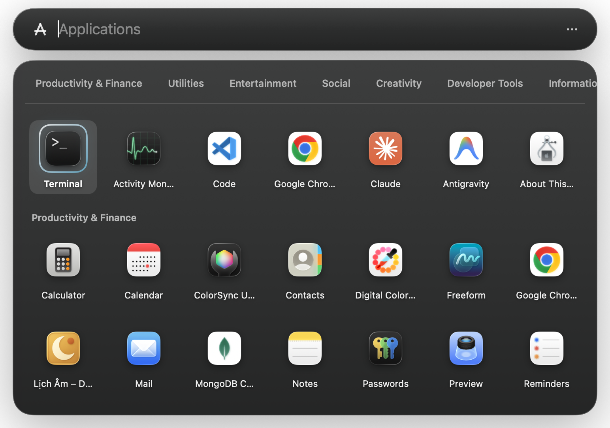

# Lightspot 🔍

[English](README.md) | [简体中文](README_zh-CN.md) | [Español](README_es.md) | [日本語](README_ja.md) | [Français](README_fr.md)

> **纯粹的Swift构建，macOS Spotlight的轻量级、完美像素替代品 — 专为需要极速响应且免受文件索引臃肿困扰的开发者和高级用户设计。**

Lightspot忠实再现了macOS Spotlight现代的悬浮胶囊设计和半透明玻璃美学（`NSVisualEffectView`）。在底层，它提供亚毫秒级的响应能力（搜索时间 < 1.0毫秒），**完全没有后台文件索引**。空闲时唯一的周期性工作是每0.6秒一次的轻量级剪贴板检查，并且仅占用不到**25MB的RAM**。



---

## ⚡ 快速开始

### 📦 单行下载与安装
只需在终端中复制并粘贴此命令，即可自动下载、解压并将最新的 **Lightspot** 直接安装到 `/Applications` 文件夹中：

```bash
curl -fsSL https://raw.githubusercontent.com/openhoangnc/mac-lightspot/main/install.sh | bash
```

*(可选：若要安装到 `~/Applications`，请使用：`curl -fsSL https://raw.githubusercontent.com/openhoangnc/mac-lightspot/main/install.sh | bash -s -- --user`)*

---

### 🗑️ 彻底卸载
如需彻底卸载，此命令可安全停止应用、取消开机自启项、清除用户偏好设置并删除应用程序包；如果 Lightspot 曾关闭 Apple Spotlight，还会将其重新启用（重新开启索引需要管理员密码，也可以稍后自行运行打印出的 `sudo mdutil -a -i on` 命令）：

```bash
curl -fsSL https://raw.githubusercontent.com/openhoangnc/mac-lightspot/main/uninstall.sh | bash
```

*(可选：`curl -fsSL https://raw.githubusercontent.com/openhoangnc/mac-lightspot/main/uninstall.sh | bash -s -- --dry-run` 仅显示将要执行的更改而不做任何修改；改用 `--keep-spotlight-disabled` 则保持 Spotlight 关闭。)*

---

## 💡 为什么选择Lightspot？

Apple内置的Spotlight是为普通文件搜索设计的。但对于开发者和高级用户来说，Spotlight的后台进程经常会造成严重的系统负担。**Lightspot正是为了解决这个问题而诞生的。**

### 问题：Apple Spotlight

1. **CPU和电池消耗：** 后台守护进程（`mds`、`mdworker`）主动对文件进行索引。一个简单的 `npm install` 或 `git checkout` 就能让你的CPU占用率飙升到100%，导致风扇狂转、电池电量锐减。
2. **应用丢失：** Spotlight的索引经常损坏，导致它无法完成最基本的工作：查找Terminal或Slack等应用。修复这个问题需要运行晦涩的 `mdutil` 命令，从头开始重建索引。
3. **磁盘占用膨胀：** Spotlight会悄悄地将元数据缓存到一个隐藏的 `/.Spotlight-V100` 文件夹中。在开发者的机器上，这个索引经常膨胀到 **50GB–200GB**，浪费了昂贵的SSD存储空间。
4. **内存囤积：** Spotlight进程经常出现内存泄漏，消耗数GB的统一内存（RAM）——这些内存本应留给你的IDE、Docker或本地LLM使用。
5. **不必要的文件抓取：** 通过系统设置排除像 `node_modules`、`.git` 或 `.venv` 这样庞大的文件夹不仅笨拙、缓慢，而且在macOS更新期间经常被重置。

*(参见社区报告：[高CPU](https://www.reddit.com/r/MacOS/comments/1p10c3f/pages_caused_insane_cpu_spikes_on_macos_i_think_i/)、[应用丢失](https://www.reddit.com/r/MacOS/comments/1gjhiha/spotlight_not_looking_for_apps/)、[存储浪费](https://dev.to/vvo/how-to-avoid-spotlight-using-hundreds-of-gbs-and-rebuild-its-index-4kki)、[内存泄漏](https://discussions.apple.com/thread/256167358?sortBy=rank))*

---

## ⚡ 解决方案：零索引架构

Lightspot通过采取一种截然不同的方法来解决这些问题：**零后台文件索引。**

Lightspot不主动抓取整个硬盘，而是严格关注高级用户实际搜索的内容：应用程序、IDE项目、浏览器选项卡、书签与历史记录、开发者实用工具和自定义命令。

### 比较矩阵

| 指标 | Apple Spotlight | Raycast / Alfred | Lightspot 🔍 |
|:---|:---|:---|:---|
| **文件索引** | 无法控制的后台抓取 | 可选 / 可配置 | **从不** (通过架构保证) |
| **空闲CPU使用率** | 操作期间峰值超过100% | 1% – 5% (后台) | **极低** (无索引；仅每0.6秒检查一次剪贴板) |
| **磁盘存储** | 10 GB – 200 GB+ 隐藏缓存 | 100 MB – 1 GB | **无索引或缓存** (仅 `UserDefaults` 中的设置和一个锁文件) |
| **RAM占用** | 500 MB – 2 GB+ | 200 MB – 500 MB | **约15 – 25 MB** (纯Swift) |
| **应用启动** | 经常损坏；需要重建 | 可靠 | **100%可靠** (直接扫描) |
| **搜索延迟** | 防抖处理 (50 – 200 ms) | 10 – 30 ms | **< 1.0 ms** (瞬时同步) |
| **离线隐私** | 发送Siri遥测至Apple | 需要同步账号 | **本地运行且无遥测**（仅在可选的更新检查、您主动发起的IP查询，以及打开 Clean Dev Mac 获取 cdm 清理规则时联网） |

---

## 🛠️ 开发者优先的自定义与高级用户工作流

Lightspot从一开始就被设计为开发者的主要控制中心。每一个方面都可以根据你对终端、编辑器、脚本和工作流的具体需求进行塑造：

### 1. ⚡ 自定义命令与脚本运行器 (`⌘⇧C`)
使用 **`⌘⇧C`** 打开交互式自定义命令编辑器，以创建和管理自定义快捷方式：
- **4个运行引擎**：
  - `terminal`：直接在你首选的终端模拟器中执行命令。
  - `shell`：通过 `/bin/zsh` 在后台无头执行。
  - `applescript`：执行原生macOS AppleScript自动化脚本。
  - `url`：在默认浏览器中打开模板化URL。
- **动态参数扩展**：
  - 使用 `{query}`、`%s` 或 `%@` 来替换你在命令后输入的任何参数。
- **前缀触发器**：
  - 为命令设置你自己的前缀，然后输入 `<前缀> <查询>`（例如 `c <url>` 请求curl headers，`png <host>` 进行ping操作）。编辑器的 **Presets** 菜单提供九个现成命令：`gh`、`g`、`yt`、`so`、`ddg`、`wiki`、`npm`、`png` 和 `c`。
- **自定义关键字与图标**：
  - 添加模糊关键字以实现即时发现。命令图标默认使用其运行器的应用图标（浏览器、终端或脚本编辑器）；你也可以切换为运行器的内置符号，或选择自己的图片或应用程序文件。

### 2. 💬 动态文本代码段
Lightspot内置五个文本代码段——`date`、`iso`、`uuid`、`shrug` 和 `flip`——并在你复制时即时展开动态变量：
- `{{date}}`：当前日期 (`YYYY-MM-DD`)
- `{{time}}`：当前时间 (`HH:mm:ss`)
- `{{iso}}`：ISO 8601 UTC 时间戳 (`2026-09-05T14:30:00Z`)
- `{{uuid}}`：随机UUID v4
- `{{clipboard}}`：当前剪贴板的内容

输入代码段关键字（例如 `iso`、`uuid`、`date`）或名称的一部分，并按 **`↵`** 即可将计算后的字符串直接复制到剪贴板。

### 3. 💻 从7种现代终端模拟器中选择
Lightspot与你最喜欢的终端模拟器集成。随时通过菜单栏切换：
- **Ghostty**、**Warp**、**Alacritty**、**iTerm2**、**Kitty**、**WezTerm** 和 **Apple Terminal**。（Warp 可以打开文件夹，但无法接收其他应用传入的命令，因此选择 Warp 时，历史命令、置顶命令和自定义终端命令会在 Apple Terminal 中运行。）
- **"Finder文件夹中的终端"**：输入 `term` 或按下操作，即可在Finder当前打开的目录中立即启动你首选的终端。

### 4. 📂 多IDE最近项目发现
Lightspot自动监控以下最近工作区：
- **VS Code**、**Cursor**、**Zed**、**JetBrains IDE** (IntelliJ IDEA、PyCharm（含社区版）、WebStorm、GoLand、CLion、RustRover、Rider、PhpStorm、DataGrip、RubyMine、DataSpell)、**Android Studio** 和 **Sublime Text**。
- **键盘修饰键**：
  - `↵` (Return)：在关联的IDE中打开工作区。
  - `⌘↵` (Command + Return)：在项目根目录启动首选终端。
  - `⌥↵` (Option + Return)：在Finder中显示项目文件夹。

### 5. 🔌 进程终止器与端口终止器 (`kill`)
快速终止残留的开发服务器、卡住的后台任务或恶意进程：
- **按端口终止：** `kill :3000`, `kill :8080`, `kill :5173` (通过 `lsof` 解析正在*监听*该端口的进程；仅连接到该端口的客户端不会被列出)。
- **按进程名或PID终止：** `kill node`, `kill python`, `kill 14205`。系统进程（`launchd`、`kernel_task`、`WindowServer`、`loginwindow`）和 Lightspot 自身永远不会被列出。
- **终止级别：**
  - `↵` (Return)：优雅终止 (`SIGTERM`)。
  - `⌥↵` (Option + Return)：强制终止 (`SIGKILL`)。

### 6. 🛠️ 内置离线开发者工具 (DevTools)
在毫秒内执行常见的开发者操作，无需打开Web实用工具或安装CLI包：
- **`uuid`**：生成具有密码学安全性的随机UUID v4。
- **`b64 <text>`** / **`b64d <base64>`**（或 **`b64 decode <base64>`**）：Base64编码与解码。
- **`urlencode <url>`** / **`urldecode <url>`**：URL百分号编码。
- **`hash <text>`** / **`hash sha256|sha1|md5 <text>`**：即时加密校验和——一次显示全部三种，或只显示指定的算法。
- **`jwt <token>`**：解码并漂亮地打印JWT头部和负载。
- **`json <raw>`**：格式化、缩进和验证压缩JSON。
- **`epoch`** / **`now`**：当前Unix时间戳；**`epoch <时间戳>`** 转换为人类可读的日期，**`epoch 2024-01-15 10:30`** 则反向转换为时间戳（按本地时间，或带时区的ISO 8601）。
- **`#3498db`**：实时颜色预览色板，支持一键复制Hex、RGB和HSL。

### 7. 🔐 Sudo及特权操作的无头Touch ID
利用指纹生物识别技术执行特权维护操作（如 `Flush DNS Cache`、`Purge Inactive Memory`）：
- **无终端弹出窗口**：通过后台伪终端(PTY)运行，调用macOS的 `pam_tid.so` 实现即时Touch ID身份验证。
- **在终端中切换Sudo的Touch ID**：一个可搜索的快速操作（输入 `touch id` 或 `sudo`），在管理员授权提示后编辑 `/etc/pam.d/sudo_local`，让你在常规终端中的 `sudo` 命令也能使用Touch ID。其副标题会显示当前是否已启用sudo的Touch ID。

### 8. 📜 zsh历史记录与固定命令 (`⌘P` / `⌘⇧P`)
- 搜索本地的 `~/.zsh_history` (或自定义的 `$HISTFILE`)，提供亚毫秒级的即时排名。
- 在任何历史命令上按 **`⌘P`** 将其固定到启动器的顶部。
- 按 **`⌘⇧P`** 管理、重新排序或删除固定命令。

### 9. 📦 设置备份与跨机同步
- 在菜单栏中使用 **Export Settings…** / **Import Settings…**，将配置导出为干净的JSON文件或从中导入。内容包括自定义命令、固定的shell命令、搜索历史与排名、最近使用的应用，以及偏好设置（全局热键、登录时启动、菜单栏图标可见性、浏览器历史范围）。文本代码段、首选终端和默认网页搜索引擎不包含在内。
- 自动路径净化会将 `/Users/username` 替换为 `~`，这样配置就可以在工作Mac和个人Mac之间无缝共享。

### 10. 🔄 内置自动更新
- 在后台检查GitHub Releases（启动后不久，以及打开菜单栏菜单时），并从菜单栏提示新版本。检查成功后会间隔一天再检查；检查失败（离线、被限流）时会在下次启动或打开菜单时重试。**`Check for Updates...`** 可随时手动运行，**`Automatically Check for Updates`** 则可完全关闭自动检查。
- 原地安装：Lightspot会下载该版本、进行校验、替换自身的应用包并重新启动。**`Skip This Version`** 只会忽略这一个版本，而不会关闭检查。
- 每次下载都有门槛：仅限HTTPS、仅限GitHub主机（重定向后会再次校验），解压后的应用包必须带有Lightspot的包标识符、可运行的可执行文件，以及与公布版本完全一致的版本号，且绝不接受比已安装版本更旧的构建。
- 发布版本采用临时（ad-hoc）签名（本项目不附带Developer ID），因此没有可供验证的代码签名——以上检查加上通往GitHub的HTTPS就是全部的信任模型，与 `install.sh` 已经要求的完全相同。

### 11. 🧹 Clean Dev Mac (`cdm`)
[CleanDevMac](https://github.com/cleandevmac/cdm)（`cdm`）能找出占用磁盘的开发缓存和构建产物；Lightspot 在面板中直接运行它。输入 `cdm`、`clean dev mac` 或缓存名称（`derived data`、`npm cache`）并按下 **`↵`**：
- **先测量，不盲目勾选**：cdm 规则涵盖的每个类别（Xcode DerivedData、Go、npm/pnpm/Yarn、Gradle、Cargo、pip/uv、CocoaPods、JetBrains、浏览器和 Electron 应用缓存、未使用的 Android 镜像等）都会像 `du` 一样测量，按大小从大到小排列，并按 cdm 的安全默认值勾选。面板会显示清理前后的磁盘状态。
- **代码库也一起**：测量完缓存后，Clean Dev Mac 会像 cdm 一样询问是否也扫描您的代码库中的构建和依赖垃圾；按 **`⇥`** 即可。每个代码库一行，列出其中的 `node_modules`、`dist`、`build`、`target`、`__pycache__` 以及其他被 git 忽略的文件，默认不勾选。只有代码库自己的 git 确认忽略的内容才会列出（被跟踪的 `build/` 会保留），`.env*` 文件，以及包含其他检出副本（克隆、git worktree、子模块）或位于其中的内容，永远不会列出。可再生的文件夹会被删除；其他被忽略的文件会移到废纸篓。
- **按键**：`↑↓` 选择（选中的行会显示其路径和大小），`Space` 勾选，`⇥` 扫描代码库，`↵` 显示逐项清理计划，再按一次 `↵` 开始清理，`⌥↵` 在访达中显示所选缓存，`Esc` 返回。
- **与 cdm 相同的规则**：Lightspot 读取 cdm 自己的规则文件：如果有 `~/.cleandevmac/rules` 就用它，否则使用 GitHub 上 cdm 的最新规则，再否则使用应用内置的副本。因此 cdm 能清理的缓存，Lightspot 也能清理。
- **与 cdm 相同的安全性**：执行任何操作之前，每个路径都要通过 cdm 的安全检查：必须位于您的主文件夹内（解析符号链接后），并且绝不触碰 `~/Documents`、`~/Desktop`、`~/Downloads`、`~/Pictures`、`~/Movies`、`~/Music`、`~/.ssh`、`~/.gnupg` 和 iCloud 云盘。清理之前，计划会列出仍在运行、会重新写入其缓存的应用（请先退出它们）。每次清理都会记录到 `~/.cleandevmac/clean.log`，与 cdm 使用同一份日志。
- **其余一键直达**：Docker / Podman、已卸载应用的残留数据以及沙盒应用的缓存需要容器引擎或对应用的扫描，因此 `⌘↵` 会在您首选的终端中直接从最新发布版本运行完整的 cdm。

### 12. 📦 一键安装：setup-zsh、MacStats 与开发工具
输入 `install`（或工具名称）并按下 **`↵`**：Lightspot 会在您首选的终端中运行该工具自己的安装程序，每一步都清晰可见。
- **Install setup-zsh**（[setup-zsh](https://github.com/openhoangnc/setup-zsh)）：可匹配历史记录任意位置的 zsh 自动建议、语法高亮，以及显示 git 状态的提示符。运行 `setup.sh` 后，打开一个加载了它的新 zsh。安装后，同一行可用于更新。
- **Install MacStats**（[mac-stats](https://github.com/openhoangnc/mac-stats)）：在菜单栏显示 CPU、内存、网速和 CPU 温度。运行其 `install.sh`，将其安装到 `/Applications` 并启动。
- **Install Dev Tools**：setup-zsh 的 `install-dev-tool` 菜单：Homebrew、Node.js、Go、Python 与 uv、Rust、JDK、Bun、Git、VS Code、Chrome、OrbStack、Android Studio 等，还能更新您的全局软件包。输入 `install node`、`install go`、`install rust` 等即可；如果没有 setup-zsh，该行会先安装它。
- 每一行都会显示工具是否已安装；**`⌥↵`** 打开其 GitHub 页面。

### 13. 🎛️ macOS 调整
那些您通常会从 dotfiles 的 README 中复制的 `defaults write` 单行命令，现在是快捷操作。每个开关都会读取当前设置并将其反转，因此同一行即可恢复：
- **程序坞**：**Clear Dock Icons**（移除所有固定的应用并重启程序坞：`defaults write com.apple.dock persistent-apps -array && killall Dock`）、**Toggle Dock Auto-Hide**、**Toggle Instant Dock Auto-Hide**（无延迟）、**Toggle Dock Recent Apps**、**Restart Dock**。
- **访达**：**Toggle Hidden Files in Finder**、**Toggle File Extensions in Finder**、**Toggle Finder Path Bar**、**Toggle Desktop Icons**（屏幕共享前很实用）、**Toggle .DS_Store on Network & USB Drives**、**Restart Finder**。
- **输入与截图**：**Toggle Press-and-Hold Accents**（按住按键即可重复输入）、**Toggle Smart Quotes & Dashes**、**Toggle Screenshot Shadows**。

均无需管理员密码。Clear Dock Icons 无法撤销；开关类操作可以恢复。

---

## ✨ 额外的内置功能

- **精确的macOS Spotlight UI**：带有动画展开和预览窗格（`NSVisualEffectView`）的浮动半透明超椭圆胶囊。
- **Mach / IOKit硬件HUD**：即时、无子进程的硬件诊断 (`sys`, `cpu`, `ram`, `memory`, `disk`, `battery`, `uptime`, `specs`, `resources`)：
  - 标准化多核CPU负载 %
  - 活动、固定、压缩和总物理RAM
  - 引导SSD可用和总存储空间
  - 电池百分比和充电状态
- **智能计算与灵活转换**：支持单位、货币和数字基数的完整递归下降数学解析器：
  - 数学：`(25 * 4) + sqrt(144)`, `2^16`, `log(1000)`
  - 单位：`100km in mi`, `72F in C`, `16GB in MB`
  - 货币：`$100 in EUR`, `50 GBP in USD`
  - 数字基数：`0xFF in dec`, `255 in hex`, `0b1010 in dec`
- **默认浏览器书签、历史记录与标签页**：仅为当前处于活动状态的默认浏览器（**Chrome**、**Safari**、**Firefox**、**Arc**、**Brave**、**Edge**）提供零冗余集成。书签和近期历史记录直接从浏览器自身的文件中读取（历史记录涵盖最近3天或7天，默认7天，也可通过菜单栏的 **Browser History** 关闭）；打开的标签页则通过Safari和基于Chromium的浏览器查询。
- **内存中的临时剪贴板**：仅限RAM的易失性环形缓冲区（最多50项），可通过 `clip <query>` 访问。从不写入磁盘，并严格过滤密码管理器（`1Password`、`Bitwarden`）。
- **macOS系统设置深层链接**：46 个直接深层链接，用于打开特定的macOS设置窗格 (`x-apple.systempreferences:...`)，可用系统设置自身搜索所用的关键词查找 (`night shift`, `lockdown mode`, `sticky keys`)，支持你的系统语言。
- **多引擎网页搜索**：内置前缀快捷键：`g` (Google), `gh` (GitHub), `so` (StackOverflow), `npm`, `crates`, `wiki`, `mdn`, `yt`, `ddg`，另有 `brew <formula>`，它会打开 formulae.brew.sh 上对应formula的页面，而不是执行搜索。

---

## 🛑 完整的macOS Spotlight管理

Lightspot在菜单栏中内置了自动化功能，以禁用或重新启用Apple内置的Spotlight：

1. **Spotlight快捷键 (`⌘Space`)**：在无需root的情况下，禁用或恢复Apple默认的Spotlight热键——包括 `⌘Space`（「显示Spotlight搜索」）和 `⌥⌘Space`（「显示Finder搜索窗口」）。更改通过偏好设置守护进程写入，并通过回读进行验证，立即生效（无需注销）；而且一旦macOS释放 `⌘Space`，Lightspot便会立即将其收归自用。
2. **后台进程 (`com.apple.Spotlight`)**：通过 `launchctl` 禁用或启用Spotlight GUI后台代理。启用时还会加载并启动该代理，因此无需注销即可恢复Spotlight。
3. **文件索引 (`mdutil`)**：完全关闭所有挂载卷上的文件系统元数据索引 (`mds` / `mds_stores`)。
4. **一键主操作**：
   - **`Disable Everything (Shortcut + Process + Indexing)...`**：彻底关闭Apple Spotlight，以收回CPU、RAM、磁盘空间和 `⌘Space`。
   - **`Restore Default Spotlight...`**：随时将所有设置恢复为出厂macOS默认值。

---

## 🚀 构建与安装 (无需Xcode)

### 📦 方式A：单行命令安装 (推荐)
直接下载并安装最新预构建版本：
```bash
curl -fsSL https://raw.githubusercontent.com/openhoangnc/mac-lightspot/main/install.sh | bash
```

### 🛠️ 方式B：从源码构建 (本地代码库)
```bash
# 1. 构建发布版本
./build.sh
# 或者: make build

# 2. 直接运行
./run.sh
# 或者: make run

# 3. 安装至 /Applications (或加 --user 安装至 ~/Applications)
./install.sh
# 或者: make install

# 4. 卸载
./uninstall.sh
# 或者: make uninstall
```

### 4. 测试与验证
Lightspot没有XCTest目标。`scripts/` 下有两个独立脚本，会随源码一起即时编译，并需在仓库根目录下运行：逻辑与引擎测试运行器（41个测试块）和实时系统验证器（11个部分，在配置齐全的机器上共136项检查；例如没有zsh历史记录、未安装VS Code或无法访问GitHub时，部分检查会被跳过）：
```bash
# 核心逻辑与引擎测试 (41个测试块)
swiftc -o /tmp/test_engine scripts/test_engine.swift Sources/Lightspot/Core/*.swift Sources/Lightspot/System/TerminalLauncher.swift Sources/Lightspot/System/AutoStartManager.swift Sources/Lightspot/System/SpotlightManager.swift Sources/Lightspot/System/FirstRunManager.swift Sources/Lightspot/System/UpdateManager.swift Sources/Lightspot/System/SingleInstanceGuard.swift Sources/Lightspot/System/LegacyNetworkStores.swift Sources/Lightspot/System/HotkeyManager.swift Sources/Lightspot/System/SystemShortcutConflicts.swift && /tmp/test_engine

# 实时系统检查 (11个部分，配置齐全的机器上共136项检查)
swiftc -o /tmp/deep_verify scripts/deep_verify.swift Sources/Lightspot/Core/*.swift Sources/Lightspot/System/TerminalLauncher.swift && /tmp/deep_verify
```

---

## ⌨️ 快捷键与导航

| 按键 | 动作 |
|---|---|
| **`⌘Space`** / **`⌘⇧Space`** / **`⌥Space`** / **`⌃Space`** | 在任何位置呼出或关闭Lightspot（可在菜单栏中配置） |
| **`↓` / `↑`** | 在搜索结果中导航 |
| **`Return` (`↵`)** | 打开所选应用、在IDE中打开项目、运行命令或复制计算结果 |
| **`⌘Return` (`⌘↵`)** | 在首选终端中打开所选项目 |
| **`⌥Return` (`⌥↵`)** | 在Finder中显示项目 / 强制终止所选进程 (`SIGKILL`) / 打开安装项的 GitHub 页面 |
| **`⌘P`** | 固定或取消固定所选终端历史记录命令 |
| **`⌘⇧P`** | 打开固定命令管理器浮层 |
| **`⌘⇧C`** | 打开自定义命令管理器浮层 |
| **`Space`** | 在 Clean Dev Mac 中勾选或取消勾选类别 |
| **`Tab` (`⇥`)** | 在 Clean Dev Mac 中同时扫描代码库 |
| **`⌘Y` / `⌘⇧H`** | 打开搜索历史记录管理器浮层 |
| **`Escape`** | 关闭浮层、清除搜索字段或关闭Lightspot |
| **点击外部** | 自动关闭悬浮面板 |

呼出所用的快捷键可在菜单栏的 **Shortcut** 中从四者里选择。macOS 将 `⌃Space` 指定为「选择上一个输入源」，因此选用它时，该按键也会切换输入源；**Shortcut** 子菜单会指出哪个系统快捷键已占用所选的组合。

---

## 🔒 隐私与安全保证

- **零文件索引**：Lightspot绝不会对您的个人文件、文档、下载或代码库进行索引。Clean Dev Mac 只测量 cdm 规则所指定的缓存文件夹，且仅在您打开它时进行，除大小外不保留任何内容；它从不读取其他应用的沙盒容器。当您要求它扫描代码库（`⇥`）时，它会在您的主文件夹中查找 git 代码库，最多六层，不进入 `~/Library`、`~/Documents`、`~/Desktop`、`~/Downloads`、`~/Pictures`、`~/Movies` 和 `~/Music`，并询问每个代码库的 git 忽略了哪些文件。
- **纯RAM的临时剪贴板**：剪贴板历史记录仅保留在易失性内存中，并主动忽略隐藏/密码管理器类型（`org.nspasteboard.ConcealedType`、`1Password`、`Bitwarden`）。它从不写入磁盘，也不会进入搜索历史；搜索历史同样不会保存您从计算器、开发者工具或代码段结果中复制的文本。
- **默认浏览器隔离**：书签、已打开的标签页和近期浏览历史仅在本机从您配置的默认浏览器中读取，避免跨浏览器抓取。
- **由用户触发的命令**：您的命令、脚本和快捷操作只有在明确的用户操作（`Return` 或 `⌘↵`）下才会运行。
- **零遥测，仅与两个由您掌控的服务通信**：没有分析统计、没有追踪、无需账号。Lightspot 自身只与两个服务通信，且两者都由您决定。第一个是用于更新的 GitHub：向公共发布 API（`api.github.com/repos/openhoangnc/mac-lightspot/releases/latest`）发出未经身份验证的 `GET` 请求，`User-Agent` 为 `Lightspot/<版本> (+https://github.com/openhoangnc/mac-lightspot)`；它在启动后不久以及打开菜单栏菜单时发出，但检查成功后每天最多一次（检查失败会在下次启动或打开菜单时重试）。在菜单栏中关闭 **`Automatically Check for Updates`**，它便不会自行发出。安装您接受的更新时，会从 GitHub 下载其 zip 文件（`User-Agent: Lightspot/<版本>`）。两者都使用临时（ephemeral）会话，因此不会在磁盘上保存任何响应或 Cookie。旧版本使用的是 macOS 的共享会话（更新检查直到 1.2.0，IP 查询在 1.2.0 之前），会把响应留在 `~/Library/Caches/com.lightspot.app`，把 Cookie 留在 `~/Library/HTTPStorages`；Lightspot 会在启动时删除这些残留，卸载程序也会将其删除。第二个是 ipify：`GET https://api.ipify.org`（第三方服务），用于获取您的公网IP，并且只在您主动查询时发出：输入明确指向它的查询（`ip`, `my ip`, `public ip`, `ipv4`），或在 **IP Address** 行上按下 `Return`。与任何网站一样，ipify 会看到您的IP地址和一个标准的 macOS User-Agent。查询结果仅在内存中缓存 15 分钟，从不写入磁盘。打开 **Clean Dev Mac** 时，还会向 GitHub 请求 cdm 的规则文件（`GET https://raw.githubusercontent.com/cleandevmac/cdm/main/rules/index.json` 及其中列出的文件，使用标准的 macOS User-Agent，通过临时会话发出），每小时最多一次；规则只保存在内存中，没有网络时使用应用内置的副本。将您自己的规则放在 `~/.cleandevmac/rules` 中即可完全不发出此请求。在终端中运行 cdm（`⌘↵`）会从 cdm 的 GitHub 发布版本下载其脚本，与 cdm 自己的说明一致。安装类的行也是如此：每一行都在您的终端中运行对应工具的安装程序，从 GitHub 下载的是该脚本，而不是 Lightspot。网页搜索、URL 和书签由您的浏览器打开，且仅在您按下 `Return` 时才会打开。
- **写入磁盘的内容**：Lightspot 自身的偏好设置（`UserDefaults`，位于 `~/Library/Preferences/com.lightspot.app.plist`）、一个锁文件、安装更新期间的临时文件，以及清理时写入 cdm 日志的记录：
  - 设置：`lightspot_hotkey_option`, `lightspot_terminal_app`, `lightspot_search_engine`, `lightspot_browser_history_days`, `lightspot_hide_menubar_icon`, `lightspot_auto_start_enabled`, `lightspot_first_run_completed`, `lightspot_spotlight_state`（最近一次检测到的 Spotlight 状态，用于菜单显示）、`lightspot_auto_update_enabled`, `lightspot_last_update_check`, `lightspot_skipped_version`（自动更新检查）。
  - 您创建的内容：`lightspot_pinned_commands`, `lightspot_custom_commands`, `lightspot_snippets`。
  - 使用记录：`lightspot_recent_app_bundle_ids`（最近启动的应用）和 `lightspot_search_history`：您输入的查询和打开的结果（标题、应用与项目路径、URL、Shell 命令），以及用于排序的选择次数。可在搜索历史管理器（`⌘Y`）中查看或清除。剪贴板、计算器和开发者工具的选择从不记录；代码段和硬件报告的选择只保留查询词和次数，绝不保存复制的文本。
  - `~/.cleandevmac/clean.log`：仅在您使用 Clean Dev Mac 清理时写入。每次清理删除或移到废纸篓的内容，会追加到 cdm 自己使用的日志中（与 cdm 一样以 1 MiB 为上限）。您在清理器中确认的内容会被永久删除，标记为 Trash 的类别除外，它们会被移到废纸篓。
  - `~/Library/Application Support/Lightspot/com.lightspot.app.lock`：防止启动第二个副本。其中记录正在运行的进程的 PID，以及其可执行文件的路径、inode 和修改时间，以便新的启动能区分是同一构建还是更新的构建。
  - 安装您接受的更新期间：下载的文件、解压后的应用包和一个小型辅助脚本位于 macOS 临时目录（`NSTemporaryDirectory()`，文件夹 `lightspot-update-…` 与 `lightspot-updater-…`）中，旧版本会以 `Lightspot.app.lightspot-old` 保留在应用旁边，直到新版本就位。辅助脚本完成后会将它们全部删除。
  - **Export Settings** 只会将 JSON 备份（包含搜索历史）写入您选择的文件。
